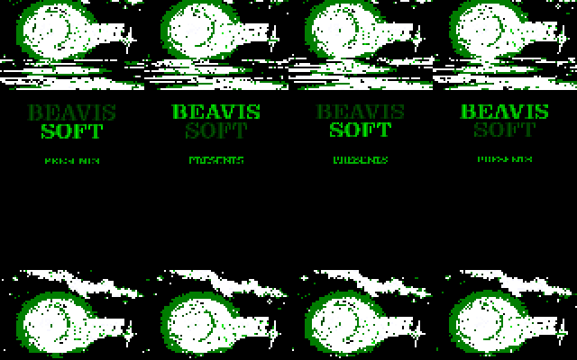

# Wacky Wheels — Static Recompilation

## What it is

A static recompilation of **Wacky Wheels** (Beavis Soft / Apogee, 1994), the
kart racer, from its shipping DOS executable, `WW.EXE`, to a native Windows
program. `WW.EXE` is a 32-bit Watcom C program bound to DOS/4G; pcrecomp's LE
front end lifts it to C, and its DOS/4GW host (`runtime/dos32`, the one Theme
Park runs on) answers DOS, DPMI, the BIOS, the VGA, the timer and the keyboard.
No emulator, no DOSBox.

Built on the [pcrecomp](https://github.com/sp00nznet/pcrecomp) toolchain and
following its shared house style (layout, CLI, `run_lift.py` + `build.cmd`,
`Setup.cmd` quick start, launcher). The lift driver and the build come from the
[Theme Park recomp](https://github.com/sp00nznet/themepark-recomp).

## Status: **v0.1.0, early alpha. It boots and runs its menus, but the screen is not right yet.**

| Stage | State |
|---|---|
| Version recompiled | the CD rerelease's `WW.EXE`, v1.1 registered (SHA-1 `ea41ea5e...`) |
| Unpacking the CD's installer archives | ✅ `tools/unpack_regup.py` (PKWARE DCL) |
| Lift (`run_lift.py`) | 2,342 functions, 0 errors |
| Host (`build/wackywheels.exe`, 64-bit, clang-cl, pcrecomp `dos32`) | builds |
| Config, start-up, the Beavis Soft logo, the title, the menus | ✅ run |
| The screen | ❌ the game draws in Mode X (unchained VGA), which `dos32` does not have yet: every screen shows as four squashed copies |
| Sound | off (`WACKY.CFG` says no music, no effects) |
| Racing, input | not yet tried |
| Headless mode | `--headless` with `--seconds`, `--shot` and `--keys`; `--record out.mp4` does not exist yet ([ROADMAP.md](ROADMAP.md)) |
| Conformance harness | not yet ([ROADMAP.md](ROADMAP.md)) |
| `Setup.cmd` quick start, launcher | written; not yet run end to end on a clean machine with the CD |

## Screenshots

Real output of `build\wackywheels.exe --headless --shot`, showing where it is:
the menus run, drawn without Mode X.



## What is not in this repo

Nothing from the game: no executable, no data, no disc image, and **no
generated source**. The lifted C is produced on your machine from your own copy
by `run_lift.py`, into `src/recomp/gen/`, which is gitignored, as are the
function catalog (`analysis/`) and `work/`. The tool ships; its output never
does.

## Getting Started

You need **your own Wacky Wheels CD rerelease** (the one with the installer
archives `WW_REGUP._1` and `WW_REGUP._2`), an `.iso` of it, or a folder holding
those two files. Nothing is downloaded for you.

### Quick start: Setup.cmd

1. Download this repository (the green **Code** button, then **Download ZIP**)
   and unzip it somewhere with 1 GB free.
2. Double-click **`Setup.cmd`**.

It checks for Python 3.10+, the `pefile` and `capstone` packages, the pcrecomp
toolkit and Visual Studio 2022 with the C++ tools and clang-cl, and **asks**
before installing any of them, saying what and how big. It finds the CD in your
drives (by `WW_REGUP._1` at its root), or asks where it is (a drive, a folder,
or an `.iso`, which it mounts; `Setup.cmd -GameDir E:\` skips the question,
`-Yes` answers yes to every install). Then it unpacks the game into `game\`,
writes a silent `WACKY.CFG`, lifts `WW.EXE` and builds `build\wackywheels.exe`.
A rerun skips the finished steps. If it stops, it says why in one sentence, and
the details are in `setup.log`.

It ends with a **`Wacky Wheels`** shortcut in the folder.

The installer (recomp-launcher with [`launcher/launcher.json`](launcher/launcher.json))
runs the same `Setup.cmd`; there is no release of it yet.

### Step by step

Prerequisites: Windows 10/11, **Python 3.10+** (`py -3 --version`), **git**,
**Visual Studio 2022** (or its Build Tools) with *Desktop development with
C++* and *C++ Clang tools for Windows* (clang-cl), and the pcrecomp toolkit
cloned **beside** this repository as `pcrecomp`, on `main`:

```
some-folder\
  pcrecomp\                     <- git clone https://github.com/sp00nznet/pcrecomp
  wackywheels\                  <- this repository
```

1. Python packages:
   ```
   py -3 -m pip install --user pefile capstone
   ```
2. Unpack the game from the CD (the folder holding `WW_REGUP._1` and `._2`):
   ```
   py -3 tools\unpack_regup.py E:\ game
   ```
   It writes `SETUP.EXE`, `WW.EXE`, `WACKY.DAT` and `MODEM.PCK` to `game\`.
3. Configure it, as its SETUP would, with no sound:
   ```
   py -3 tools\make_cfg.py
   ```
   Expected: `wrote ...\game\WACKY.CFG`.
4. Lift (the first run also builds the function catalog and takes a minute):
   ```
   py -3 run_lift.py
   ```
   Expected: 2,342 functions, 0 errors, into `src\recomp\gen\`.
5. Build (clang-cl, CMake and Ninja, through the VS x64 environment):
   ```
   build.cmd
   ```
6. Run: `build\wackywheels.exe`.

The usual trip-ups: `python` opening the Microsoft Store (that is Windows' alias
placeholder; use `py -3`, or turn the alias off in *Settings > Apps > Advanced
app settings > App execution aliases*); a freshly installed Python not being on
`PATH` until you open a new window; and Visual Studio without the Clang tools
(`build.cmd` then fails to find `clang-cl`).

## Usage

```
build\wackywheels.exe                                         # in a window
build\wackywheels.exe --headless --seconds 20 --shot 15 menu.bmp
build\wackywheels.exe --headless --seconds 30 --keys "8:enter,12:down,14:enter" --log
```

| Flag | |
|---|---|
| `--game DIR` | the game folder, seen by the game as `C:\` (default `game`) |
| `--headless` | no window |
| `--seconds S` | quit after S seconds of guest time |
| `--shot S FILE` | save the screen at S seconds (up to 16) |
| `--keys "S:key,..."` | press a key at S seconds of guest time: `enter`, `space`, `esc`, `up`, `down`, ... |
| `--log` | log the DOS host's calls |

## Building from source

Steps 4 and 5 above. `PCRECOMP` (Python, and `build.cmd` passes it to CMake as
`-DPCRECOMP=`) points at a toolkit checkout other than `..\pcrecomp`; the
lifter and the runtime must come from the same tree. On
[netlab](https://github.com/sp00nznet/recomp-netlab) the recipe is
`wackywheels-recomp`: `netlab build wackywheels-recomp`. How the pieces fit is
[docs/architecture.md](docs/architecture.md); what this game needed is
[docs/lifting.md](docs/lifting.md).

## License

MIT, for the code in this repository ([LICENSE](LICENSE)).
`tools/unpack_regup.py` ports Mark Adler's `blast.c` (zlib license,
[LICENSES/Zlib-blast.txt](LICENSES/Zlib-blast.txt)); credits are in
[NOTICE](NOTICE). Wacky Wheels is © 1994 Beavis Soft and Apogee Software; none
of it is here.
