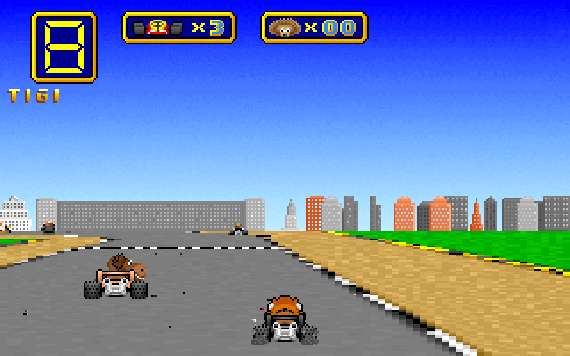
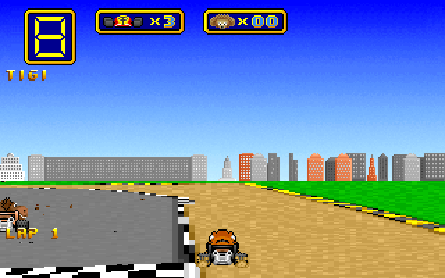

# Wacky Wheels — Static Recompilation

Static recompilation of **Wacky Wheels** (Beavis Soft / Apogee, 1994), the
kart racer, from its shipping DOS executable, `WW.EXE`, to a native Windows
program. `WW.EXE` is a 32-bit Watcom C program bound to DOS/4G; pcrecomp's LE
front end lifts it to C, and its DOS/4GW host (`runtime/dos32`, the one Theme
Park runs on) answers DOS, DPMI, the BIOS, the VGA (Mode X included), the
timer and the keyboard. No emulator, no DOSBox.

Built on the [pcrecomp](https://github.com/sp00nznet/pcrecomp) toolchain, on
its **`pcrecomp-dos32-modex`** branch (Mode X; not merged into `main` yet).
The lift driver and the build come from the
[Theme Park recomp](https://github.com/sp00nznet/themepark-recomp).

## Getting Started

You need **your own copy**: the Wacky Wheels CD rerelease (the one with the
installer archives `WW_REGUP._1` and `WW_REGUP._2`), an `.iso` or `.cue`/`.bin`
of it, or a folder holding those two files. Nothing from the game is in this
repository or downloaded for you; everything is built on your machine from your
copy.

### The setup scripts

1. Download this repository (the green **Code** button, then **Download ZIP**)
   and unzip it somewhere with 1 GB free.
2. Windows: double-click **`Setup.cmd`**. Linux and macOS: not yet
   (`setup.sh` says so and stops).
3. Play with the **`Wacky Wheels`** shortcut in that folder.

The script checks for Python 3.10+ (with `pefile` and `capstone`), Git, the
pcrecomp toolkit (cloned beside this folder on its `pcrecomp-dos32-modex`
branch) and Visual Studio 2022 with clang-cl, and asks before installing any of
them. It finds the CD in your drives or asks where it is (a drive, a folder, an
`.iso`, which it mounts, or a `.cue`, whose data track it turns into
`work\disc.iso`; `Setup.cmd -GameDir E:\` skips the question, `-Yes` answers
yes to every install). Then it unpacks the game into `game\`, writes a silent
`WACKY.CFG` with the keyboard table, lifts `WW.EXE` and builds
`build\wackywheels.exe`. A rerun skips finished steps; if it stops, it says why
in one sentence and the details are in `setup.log`. Building by hand and the
command line are in **[docs/building.md](docs/building.md)**.

Drive with the arrows; Ctrl fires, Alt is the hand-brake.

## Status

**v0.1.0 plus unreleased work, alpha: it races.** The menus, the track select
and a Bronze Wheels race on track 1, driven with the keyboard.

| Stage | State |
|---|---|
| Version recompiled | the CD rerelease's `WW.EXE`, v1.1 registered (SHA-1 `ea41ea5e...`) |
| Unpacking the CD's installer archives | ✅ `tools/unpack_regup.py` (PKWARE DCL) |
| Lift (`run_lift.py`) | 2,342 functions, 0 errors |
| Host (`build/wackywheels.exe`, 64-bit, clang-cl, pcrecomp `dos32`) | builds |
| Config, start-up, the Beavis Soft logo, the title, the menus | ✅ |
| The screen | ✅ Mode X (unchained VGA), pcrecomp branch `pcrecomp-dos32-modex` |
| Racing, input | ✅ a race with the keyboard; the skyline does not scroll when turning yet |
| Sound | off (`WACKY.CFG` says no music, no effects) |
| Headless mode | `--headless`, `--seconds`, `--shot`, `--keys`; no `--record` yet |
| Conformance harness | not yet ([ROADMAP.md](ROADMAP.md)) |
| `Setup.cmd` | tested from a fresh clone with the `.cue`/`.bin` of the CD rerelease, to the shortcut and the title screen |
| Linux, macOS | not yet |

[docs/lifting.md](docs/lifting.md) is the log of what this game needed, and
[ROADMAP.md](ROADMAP.md) what comes next.

## Screenshots

Real output of `build\wackywheels.exe --headless --shot`:

## Documentation

- [docs/building.md](docs/building.md): building by hand, the command line, netlab
- [docs/testing.md](docs/testing.md): headless runs and scripted keys
- [docs/architecture.md](docs/architecture.md): how the pieces fit
- [docs/lifting.md](docs/lifting.md): what this game needed, wall by wall
- [ROADMAP.md](ROADMAP.md), [CHANGELOG.md](CHANGELOG.md), [CONTRIBUTING.md](CONTRIBUTING.md)

## Contributors

See **[CONTRIBUTORS.md](CONTRIBUTORS.md)** for who did what.

## License

MIT for this repository's own code ([LICENSE](LICENSE)); `tools/unpack_regup.py`
ports Mark Adler's `blast.c` under the zlib license. Wacky Wheels is © 1994
Beavis Soft and Apogee Software; none of its files, and nothing generated from
them, is in this repository ([NOTICE.md](NOTICE.md)).
